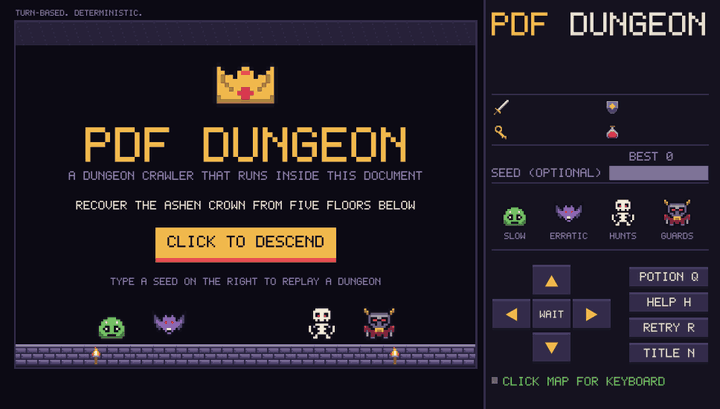
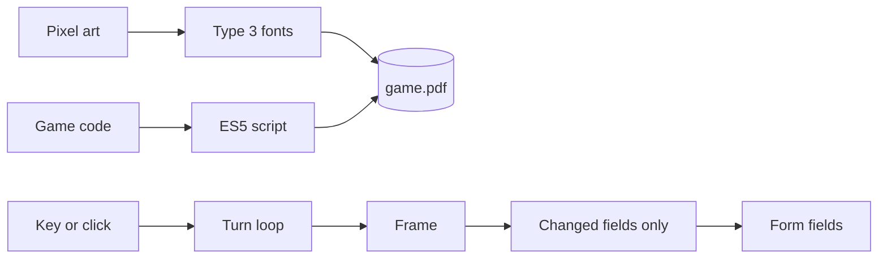

# PDF Dungeon

I built a playable dungeon-crawler game engine that executes inside a PDF document.



The whole game is one 97 KB file, [`dist/game.pdf`](dist/game.pdf). No web page around it, nothing
to install, no network. The game code is JavaScript inside the PDF, the screen is made of form
fields, and the sprites are letters in a font I generate from pixel art.

## Playing it

Drag `dist/game.pdf` into a **Chrome** window. On a Mac, double-clicking opens Preview instead,
which hasn't been tested.

Find the key on each floor, unlock the door, take the stairs, and pick up the crown on floor five.
Walk into monsters to hit them. The dark parts of the map are places you haven't been yet. If part
of the page is cut off, zoom out.

| Keys                | Does                   |
| ------------------- | ---------------------- |
| Arrows or `W A S D` | Move, attack, open     |
| `Space` or `.`      | Wait a turn            |
| `Q`                 | Drink a potion         |
| `H`                 | Help                   |
| `R` / `N`           | Retry seed / title     |
| `P`                 | Show performance panel |

There are on-page buttons too. Type a seed on the title screen to replay the same dungeon.

## Where it works

It's tested in Chrome 158 on macOS 15.6, and nowhere else. Other Chromium browsers use the same PDF
engine, so they may well work, but I haven't checked. Acrobat can't draw the tile font, so there's
an ASCII version for it, which hasn't been tried there. Viewers that don't run the script should
show a warning instead.

## How it works



- **Drawing.** Chrome ignores attempts to recolour a form field. But a Type 3 font glyph can contain
  a full-colour drawing, so setting a field's text to `#..@` draws four tiles.
- **Keyboard.** Text fields don't report arrow keys. A list box does, so the game uses one as its
  keyboard and puts the selection back in the middle after every key.
- **Testing.** A PDF in Chrome has no DOM. The game can draw a hash of its state as black and white
  squares, and the tests read that from screenshots and compare it with the engine in Node.

## Working on it

You need Node 22.18 or newer.

```sh
npm ci
npm run verify     # formatting, types, build, tests
npm run test:e2e   # plays the PDF in Chrome, add HEADFUL=1 to watch
npm run bot 2000   # balance check
npm run poc        # the experiments this started from
npm run record     # demo video, needs ffmpeg
```

```
src/engine    rules, levels, monsters; knows nothing about PDFs
src/runtime   screens, input and drawing inside the PDF
src/art       sprites, tiles, typeface
src/build     turns all of that into game.pdf
test          unit tests, plus e2e/ for Chrome
tools         bot, Chrome driver, recorder
poc           early probes and a benchmark
```

## Credits

[pdftris](https://github.com/ThomasRinsma/pdftris) and
[doompdf](https://github.com/ading2210/doompdf) showed this kind of thing was possible. I read both
for ideas; none of their code is used here. MIT licensed.
